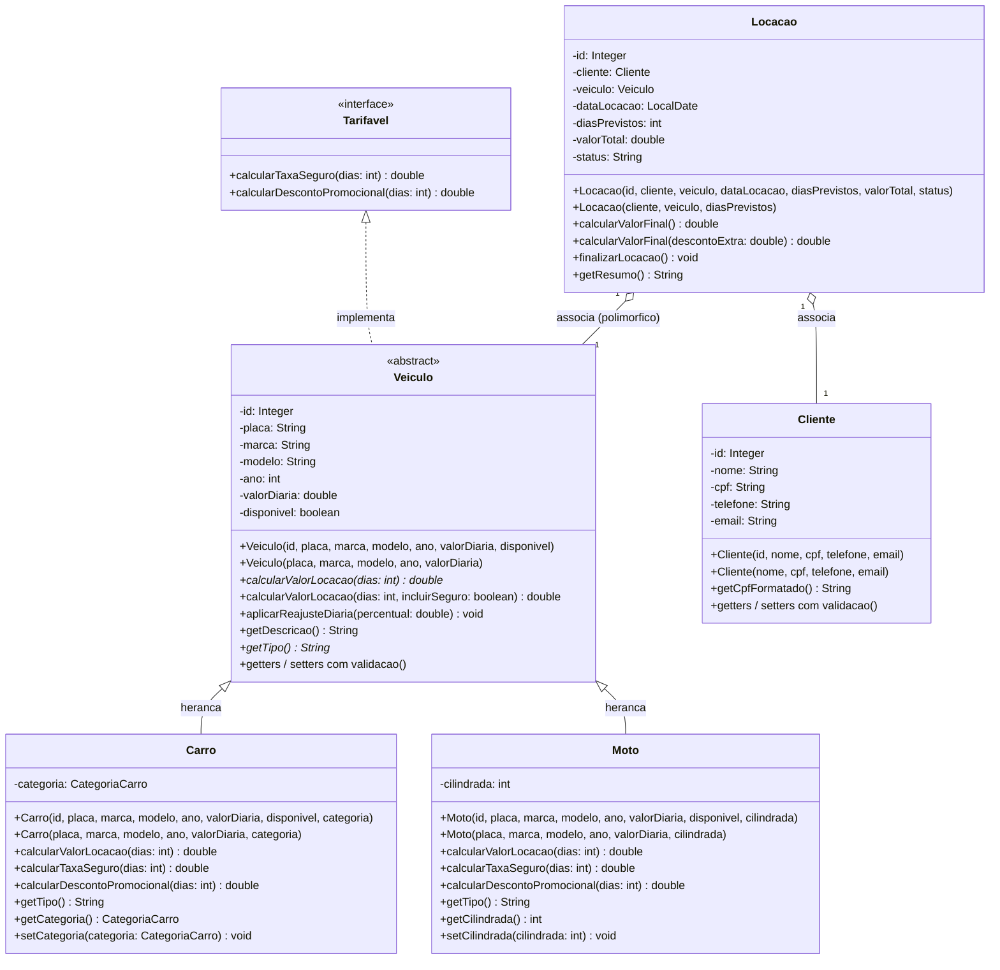

# 2. DIAGRAMA DE CLASSES E ESTRUTURA ORIENTADA A OBJETOS

## 2.1 Diagrama de Classes (Mermaid)



---

## 2.2 Representação Textual da Estrutura

```text
+-------------------------------------------------------------+
|                        <<interface>>                        |
|                          Tarifavel                          |
+-------------------------------------------------------------+
| + calcularTaxaSeguro(dias: int): double                     |
| + calcularDescontoPromocional(dias: int): double            |
+-------------------------------------------------------------+
                               ^
                               | implements
+-------------------------------------------------------------+
|                     <<abstract class>>                      |
|                           Veiculo                           |
+-------------------------------------------------------------+
| - id: Integer                                               |
| - placa: String                                             |
| - marca: String                                             |
| - modelo: String                                            |
| - ano: int                                                  |
| - valorDiaria: double                                       |
| - disponivel: boolean                                       |
+-------------------------------------------------------------+
| + calcularValorLocacao(dias: int): double [ABSTRATO]        |
| + calcularValorLocacao(dias: int, seguro: boolean): double  |
| + getTipo(): String [ABSTRATO]                              |
| + aplicarReajusteDiaria(percentual: double): void           |
| + getDescricao(): String                                    |
| + Getters e Setters com validacoes de estado                |
+-------------------------------------------------------------+
                 ^                           ^
                 | extends                   | extends
+-------------------------------+ +-------------------------------+
|             Carro             | |             Moto              |
+-------------------------------+ +-------------------------------+
| - categoria: CategoriaCarro   | | - cilindrada: int             |
+-------------------------------+ +-------------------------------+
| + calcularValorLocacao(): dbl | | + calcularValorLocacao(): dbl |
| + calcularTaxaSeguro(): dbl   | | + calcularTaxaSeguro(): dbl   |
| + calcularDescontoProm(): dbl | | + calcularDescontoProm(): dbl |
| + getTipo(): String           | | + getTipo(): String           |
+-------------------------------+ +-------------------------------+

+-------------------------------+
|            Cliente            |
+-------------------------------+
| - id: Integer                 |
| - nome: String                |
| - cpf: String                 |
| - telefone: String            |
| - email: String               |
+-------------------------------+
| + getCpfFormatado(): String   |
| + Getters e Setters validados |
+-------------------------------+
                 ^
                 | 1:N
+-------------------------------+
|            Locacao            |
+-------------------------------+
| - id: Integer                 |
| - cliente: Cliente            |
| - veiculo: Veiculo            |
| - dataLocacao: LocalDate      |
| - diasPrevistos: int          |
| - valorTotal: double          |
| - status: String              |
+-------------------------------+
| + calcularValorFinal(): dbl   |
| + calcularValorFinal(d): dbl  |
| + finalizarLocacao(): void    |
+-------------------------------+
```
